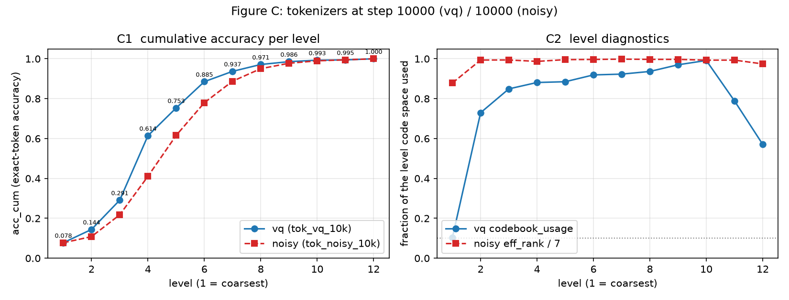

# jncm: Hierarchical Concept Prediction in Embedding Space

**Do coarse-to-fine text generators need discrete codes?** This repo tests that question. It compares discrete (vector-quantized) concept codes against continuous codes with a matched information budget, all on one shared generator.

> Status: research in progress, aiming at a 2027 workshop paper. The tokenizer stage is done; generator results are running. See [`paper/draft.md`](paper/draft.md).

## The idea

Next-Concept Modeling (NCM) compresses text into a hierarchy of discrete codes. It generates the levels coarse to fine, predicting every code in a level in parallel, and decodes text once at the end. jncm swaps the discrete codes for **continuous codes whose capacity is capped by a power constraint and Gaussian channel noise** (about 11.4 bits per position, against 12 bits for a 4096-entry codebook). It then asks what that changes:

- **Per-level predictors:** categorical (discrete), flow matching (continuous, stochastic) and regression (continuous, deterministic).
- **Joint training:** a JEPA-style objective with EMA targets and per-level variance-covariance regularization.
- **Sample collapse:** diversity metrics catch cases that generative perplexity alone misses, such as a regression head that produces near-identical samples.

## First result: tokenizers (gate G0a)

At a matched budget, both tokenizers reconstruct held-out TinyStories text almost exactly: exact-token accuracy is 0.99998 for VQ and 0.99994 for the continuous code. The continuous hierarchy is less front-loaded, though. Reconstruction from the first 4 of 12 levels reaches 0.41 for the continuous code against 0.61 for VQ, and the two meet at level 11.



## Setup

- **Data:** TinyStories, 128-token windows, 8192-token BPE vocabulary
- **Generator:** 12-layer transformer, width 768 (85.5M parameters), 12 levels, attention within each level
- **Compute:** H100s on the FIR supercomputer (Digital Research Alliance of Canada), run as chained Slurm jobs
- **Tests:** 470+ unit tests (`pytest`)

## Repo layout

| Path | What's in it |
| --- | --- |
| `jncm/tokenizer/` | VQ and noise-bounded continuous multiscale tokenizers |
| `jncm/generator/` | Level-parallel backbone, prediction heads, sampling |
| `jncm/jepa/` | Joint training: EMA targets, VICReg regularization, diagnostics |
| `jncm/eval/` | Generative perplexity (GPT-2-large) and diversity metrics |
| `configs/` | Run configurations, from smoke tests to dev runs |
| `scripts/` | Data prep, Slurm launch kit, reports and plots |
| `paper/` | Working draft and verified references |
| `tests/` | Unit tests |

## Running it

```bash
pip install -r requirements.txt
pytest                      # unit tests
```

Cluster runs are launched with `scripts/launch_phase.sh`; [`RUNBOOK.md`](RUNBOOK.md) has the full operator commands.

## Contact

Questions or ideas: open an issue on the repository.