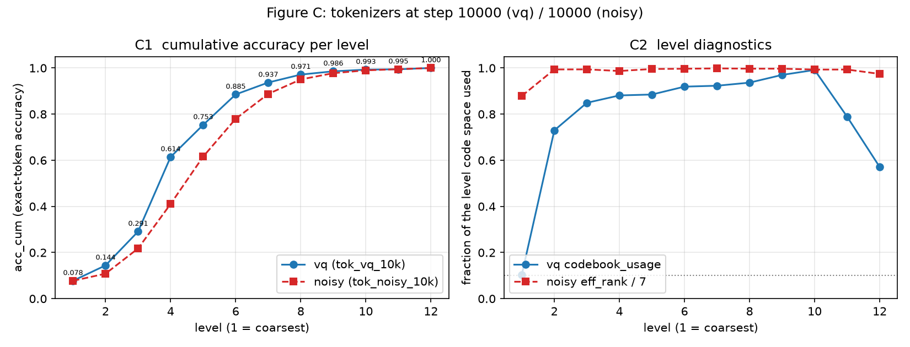

# Hierarchical Concept Prediction in Embedding Space for Text Generation

Working draft v0.1 · \[Authors\] · \[Affiliation\] · Target: ICLR 2027 workshop (suggested submission date Feb 1, 2027; specific workshop to be chosen after the Nov 29 acceptances). Title is provisional: it depends on the outcome of gate G2.

## Abstract

Coarse-to-fine text generation with discrete concept codes (NCM) produces a hierarchy of codes level by level, with all codes of a level predicted in parallel, and decodes text once at the end. We ask whether the discrete codes are essential. We replace vector-quantized codes with continuous representations whose information per level is bounded by a power constraint and Gaussian channel noise, nominally matched to the discrete budget (about 11.4 versus 12 bits per position); at this budget both tokenizers reconstruct held-out text almost exactly (exact-token accuracy 0.99998 for vq and 0.99994 for the continuous code). For each level we compare three predictors: categorical (discrete), flow matching (continuous, stochastic) and regression (continuous, deterministic). We then train the hierarchy jointly with a JEPA-style objective that uses EMA targets and per-level variance-covariance regularization. \[TBD: headline result, generative perplexity against total training positions, for vq+ce, noisy+flow, noisy+regress and JEPA.\] \[TBD: one sentence on the sample-efficiency outcome.\] A deterministic regression head cannot represent the multimodal distribution of the coarsest level and produces near-identical samples, which perplexity alone does not reveal; we quantify this with diversity metrics. \[Confirm with G1 data before keeping this sentence.\]

## 1 Introduction

Autoregressive language models generate one token at a time. NCM (Next-Concept Modeling) instead compresses a token sequence into a hierarchy of K levels of discrete codes of increasing length, generates the levels from coarse to fine with all codes of one level predicted in parallel, and decodes text once from the final cumulative reconstruction \[NCM\]. It reports about 4 to 5 times fewer training tokens than strong diffusion baselines on LM1B and OpenWebText, counting tokenizer training and repeated passes over the data \[NCM, Sec. 1 and 4.6\]. Its codes are discrete because a multiscale residual VQ-VAE is trained first and frozen. The authors name end-to-end training of the tokenizer with the generator as future work \[NCM, App. I\].

We study what changes when the codes are continuous and the generator is trained to predict representations rather than indices. Continuous targets avoid the quantization bottleneck and can be trained jointly with the encoder, in the spirit of JEPA, where a predictor maps context representations to target representations produced by an EMA copy of the encoder. Two obstacles are specific to this setting. First, a continuous code with no capacity limit can carry unbounded information, so the hierarchy can degenerate: everything ends up in the first level and generating that level becomes as hard as the whole task. Second, a deterministic predictor in embedding space returns the conditional mean, and the coarsest level of a hierarchy is the most multimodal part of the distribution.

Our contributions are:

- A controlled comparison of discrete and continuous hierarchies on one shared backbone, with a nominally matched information budget per level (about 11.4 bits for the continuous code against 12 bits for a 4096-entry codebook). \[TBD: result.\]
- A continuous multiscale code whose capacity is bounded by a power constraint and channel noise, so the hierarchy keeps its coarse-to-fine structure without quantization.
- An analysis of per-level predictors (categorical, flow matching, regression) with diversity metrics that expose sample collapse that generative perplexity cannot. \[TBD: result.\]
- A JEPA-style joint training mode with EMA targets teacher-forced on the online chain, together with an accounting rule that makes sample-efficiency comparisons between staged and joint training fair. \[TBD: result; if JEPA does not help, we report it as a negative result.\]

## 2 Related work

**Hierarchical and multiscale generation.** NCM \[NCM\] is the closest work: discrete multiscale codes, level-parallel prediction, one decoding step. Next-scale prediction is established for images \[VAR, arXiv:2404.02905\] and hierarchical discrete diffusion for language has been explored \[HDLM, arXiv:2510.08632\]. We keep NCM's structure and change the representation and the objective.

**Language modeling in a concept or latent space.** Large Concept Models predict sentence embeddings; the deterministic regression variant (Base-LCM) was outperformed by diffusion-based variants \[LCM, arXiv:2412.08821, Sec. 2.4.1\]. Continuous-latent diffusion language models also exist, for example AURORA-LM, which generates a continuous latent sequence with flow matching \[arXiv:2608.02602\]. None of these, to our knowledge, combines a multiscale residual hierarchy with coarse-to-fine prediction in a continuous space and a single decoding step. \[Re-run the novelty search before submission.\]

**JEPA and language.** JEPA-style objectives have been added to language model training \[LLM-JEPA, arXiv:2509.14252\], used to predict text embeddings that a lightweight decoder maps back to text \[VL-JEPA, arXiv:2512.10942\], and applied hierarchically to world models for visual planning \[H-JEPA, arXiv:2610.06805\]. Hierarchical latent prediction has also been added as an auxiliary objective to next-token training of language models \[HiLP, arXiv:2608.05806\]. A sample-complexity theory on hierarchical data suggests that explicit hierarchical stacking is largely redundant for representation learning \[Korchinski et al., arXiv:2605.27734\]. Our hierarchy lives on the generation side, which is a different question from representation learning.

**Alignment across modalities.** Balestriero and LeCun \[arXiv:2610.39302\] tie cross-modal alignment of separately trained JEPAs to how positive pairs are built. We study generation sample efficiency, which is a different measurement; we do not claim anything about cross-modal alignment (see Future work).

## 3 Method

**3.1 Multiscale residual hierarchy.** A sequence of L tokens x is embedded as z = Emb(x) + Pos, with shape \[L, d\]. We use K levels with lengths l\_k = 1 + (2(k-1)(L-1) + (K-1)) // (2(K-1)), so l\_1 = 1 and l\_K = L. For L = 128 and K = 12 this gives \[1, 13, 24, 36, 47, 59, 70, 82, 93, 105, 116, 128\]. Starting from the empty reconstruction zhat\_0 = 0, level k takes the residual r = z - zhat\_{k-1}, pools it to l\_k positions (area pooling), maps it to a code c\_k, and adds the reconstruction operator R\_k(c\_k) to the running reconstruction: zhat\_k = zhat\_{k-1} + R\_k(c\_k). R\_k is a linear map, linear interpolation to length L, and a depthwise convolution. A small transformer decoder maps zhat\_K to token logits. Following NCM, the tokenizer is trained with nested dropout: with probability 0.5 the decoder sees only the first k levels, with k uniform over {1..K-1}. Finer levels therefore correct what coarser levels missed.

**3.2 Discrete codes (vq).** Each level has a codebook of 4096 entries of width 64, updated by EMA (decay 0.99) with dead-code re-initialization, a straight-through estimator, and a commitment loss with weight 0.25. All vector-quantization arithmetic runs in fp32.

**3.3 Continuous codes with a capacity bound (noisy).** The level-k code is c\_k = LayerNorm(W\_k pool(r)) with width d\_k = 8, which fixes the power per position. The code used in the residual chain is c\_k + sigma \* eps with eps \~ N(0, I) and sigma = 0.4, applied in training and at evaluation. This is an additive Gaussian channel, so the information per position is at most (d\_k / 2) log2(1 + 1 / sigma^2) = 11.43 bits, against log2(4096) = 12 bits for the discrete code. The generator targets are the clean codes c\_k; because finer levels are computed from the noisy chain, they learn to correct the channel noise of coarser levels.

**3.4 Generator and per-level predictors.** A transformer with 12 layers and width 768 processes the levels with attention restricted to each level (block-diagonal). The input of level k is the cumulative reconstruction of levels 1..k-1, resampled to l\_k positions, plus normalized positions and a level embedding. All levels are trained in one pass, and sampling uses exactly K forward passes. We compare three heads: categorical (cross-entropy over codebook indices, for vq); flow matching (a small conditional MLP trained on clean codes and sampled with 8 Euler steps, for noisy); and regression (mean-squared error to the clean code, for noisy). During training the conditioning codes are corrupted by randomly swapping a fraction of them, with the rate decreasing linearly across levels from 0.8 to 0.2; targets stay clean. At sampling the continuous heads add fresh channel noise so that the decoder sees the noise distribution it was trained on.

**3.5 JEPA-style joint training.** The tokenizer encoder E, a decoder D and the generator G are trained together. An EMA copy of E supplies targets: for each level, t\_k = LayerNorm(Ebar.proj\_k(pool(zbar - zhat\_{k-1}))) where zbar is the EMA embedding of x and zhat\_{k-1} is the online noisy partial reconstruction, detached. Targets therefore live in the same chain the decoder is trained on. The loss is L = L\_dec + L\_pred + L\_vic: cross-entropy of the decoder (with nested dropout), prediction loss between the generator output and the stop-gradient targets (flow-matching or regression), and a per-level variance-covariance regularizer on the online codes and the predictions. The EMA momentum increases from 0.996 to 1 on a cosine schedule. Ablations switch off the EMA, the regularizer, the gradient from the decoder into the encoder, and the teacher-forced target chain.

## 4 Experiments

**4.1 Setup.** Data: TinyStories, windows of L = 128 tokens, BPE vocabulary of 8192. Tokenizers are trained for 10,000 steps at batch 512 (655M positions) and generators for 10,000 steps at batch 1024 (1.31B positions); the tokenizer budget was reduced from 40,000 steps for compute reasons and is the same for all variants. Metrics: generative perplexity under GPT-2-large after re-tokenizing the decoded text, mean per-sample unigram entropy, the fraction of distinct samples, and the mean pairwise token agreement between samples. Our scoring pipeline gives 10.80 perplexity and 4.03 entropy on real validation text, against 9.67 and 3.96 reported by NCM, so we compare models within our pipeline and report ratios to our own data row; absolute numbers are not comparable to NCM's. Sample efficiency is measured against total training positions; for joint runs we report both positions seen once and the conservative count that charges both objectives; both include the 655M positions of the staged continuous tokenizer that the joint run warm-starts from. \[TBD: confirm after G2.\] \[TBD: number of seeds.\]

**4.2 Tokenizers (gate G0a).** Both tokenizers train for 10,000 steps at batch 512 (655M positions, about 2.3 H100-hours each) and are evaluated on one fixed validation batch of 512 windows (65,536 tokens). The vq tokenizer reaches 0.99998 exact-token accuracy at 12 bits per position and the continuous tokenizer 0.99994 at a nominal 11.43 bits; at this sample size the difference is not significant. The hierarchies differ in the middle, though (Figure C): reconstruction from the first k levels is higher for vq at every k from 2 to 10 (level 4: 0.61 against 0.41; level 7: 0.94 against 0.89), the gap closes by level 10 (0.993 against 0.990), and the two meet at level 11 (0.9945 against 0.9948). At equal nominal budget the continuous hierarchy is therefore less front-loaded: the channel-capacity bound is an upper limit that the learned code does not reach. The continuous codes do not collapse: the mean per-dimension standard deviation is 0.91 at level 1 and at least 0.99 elsewhere, and the effective rank is 6.2 at level 1 and 6.8 to 7.0 elsewhere, out of a maximum of 7. The vq codebooks use 73% to 99% of their entries at levels 2 to 10, then lose usage at the two finest levels (79% and 57%, code perplexity 1690 and 437 out of 4096), as expected for small residuals; level-1 usage is capped by the batch (at most 512 distinct codes) and is not informative. \[Figure C: per-level reconstruction accuracy for both tokenizers, and per-level code diagnostics.\]

*Figure C. Left: exact-token accuracy of the reconstruction from the first k levels (level 1 is the coarsest) for the vq and continuous tokenizers after 10,000 steps. Right: per-level code diagnostics, vq codebook usage and continuous effective rank divided by its maximum of 7. Level-1 vq usage is capped by the evaluation batch (at most 512 distinct codes).*

**4.3 Results.** \[TBD: Figure A, generative perplexity against total positions for vq+ce, noisy+flow, noisy+regress and the JEPA runs, under both accountings.\] \[TBD: Table 1, final perplexity, entropy and diversity for each method.\] \[TBD: Figure B, per-level reconstruction accuracy and per-level explained variance of the predictors, including the collapse of the regression head at the coarsest level.\]

**4.4 Ablations.** \[TBD: the 2x2 over decoder-to-encoder gradient and regularizer; target chain (online versus EMA-clean); with and without the EMA; regression versus flow head; number of levels if budget allows.\] If the JEPA variant does not match the best staged variant, this section reports that result and the informative failures.

## 5 Discussion, limitations and future work

**Limitations.** One dataset (TinyStories), a generator of about 90M parameters, a reduced tokenizer budget, and a scoring pipeline that differs from the original NCM numbers. \[TBD: seeds and variance.\] The continuous variant's bit budget is matched analytically through the channel capacity bound, not measured; partial-reconstruction accuracy suggests the continuous hierarchy realizes less of that budget at intermediate levels (Section 4.2).

**Future work.** Our hierarchy forms positive pairs from coarse and fine views of the same text. Balestriero and LeCun \[arXiv:2610.39302\] show that JEPAs trained separately on different modalities converge to the same representation up to a rotation when their positive pairs are good views, meaning two observations of one scene. Testing how hierarchical continuous generation interacts with that convergence requires paired data. Two natural steps are a cross-lingual setting, where translation pairs such as WMT14 provide good views, and an evaluation-only alignment probe between our level representations and frozen image encoders on captioned images. A jointly trained multimodal hierarchy would additionally need an image tokenizer with its own coarse-to-fine levels, which we leave open. We also leave unconditional generation, which needs a prior over the coarsest level, and verifier-guided re-looping of levels to future work.

## Draft notes (delete before submission)

- Fill every \[TBD\] from the gate report output (Gen PPL ratio to 10.80, entropy against 4.03, diversity, both position accountings).
- References were checked on 2026-11-20 against the arXiv pages and the NCM and LCM full texts; see `paper/references_verified.md`. Still open there: the bibliography keys, the exact venue entries, and the novelty search.
- Re-run the novelty search shortly before submission and add anything new from the NCM group.
- Do not cite the 42x figure as motivation for the generation claim; it measures alignment, not generation.
- Pick the final title after G2: a win for JEPA mode versus a controlled discrete-versus-continuous study.
- Check the chosen workshop's template, page limit and anonymization rules; add compute acknowledgements.
